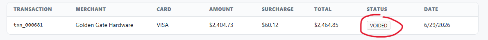
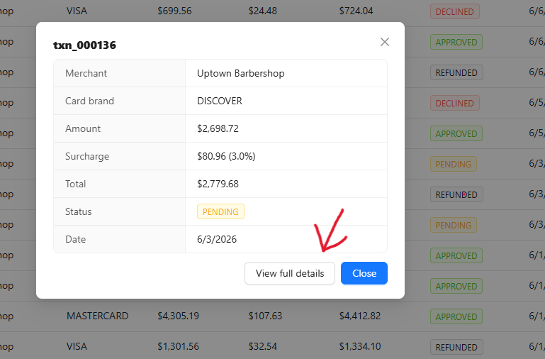

# Notes

Firstly, there are secrets committed to the repo, in `./apps/api/src/config.ts`

```
export const PORT = Number(process.env.PORT) || 4000

export const PROCESSOR_API_KEY = "***"
export const PROCESSOR_WEBHOOK_SECRET = "***"
```

moving these to the env, and marking in env.example.

## Task 1:

I think the best approach for pagination here is offset based pagination (instead of cursor), since we want to have separate viewable pages we can individually click through, which is not possible with cursor based pagination.


#### Design Choices:

- Setting default page size to 20 + max page size of 100 for security in case someone were to try and create their own payload.
- Only search transactions after a person is done typing (a timer after the last character is typed) so we aren't spamming requests.

Additionally, you would want to look into parameterization for the search query if we were using a DB.

## Task 2:

Currently, we aren't accounting for transactions that have actually been processed, so totalVolume and surcharge is accounting for refunded, denied, etc. transactions. We also aren't displaying the totalSurcharge.

#### Design Choices:

- Display totalSurcharge since it isn't being shown on the dashboard.
- Only accumulate processed transactions, and round transaction amounts where appropriate
- Extract calculation into separate functions containing the appropriate business logic. Additionally, I would also try and separate this logic entirely from the API, such that it can be accessed by other tools (ex. if someone needed to batch process transactions, or run a script, or basically anything that won't go directly through API)
- Account for a missing transaction status VOIDED:



## Task 3:

A lot seems to be missing from the new transaction page:
- form currently rounds amounts to dollars (cuts off cents)
- Any form of error validation
- user receives no submission feedback (success or fail not communicated)
- surcharge is always 0, and has no way to edit rates
- amount is not a number input
- status is always approved, which doesn't allow users to add other statuses for consistent bookkeeping.
- submit button isn't disabled while request is working.
- page not formatted like dashboard (header, etc.)
- missing a back button

I'm also putting limits on transaction amount (up to $1,000,000), and surcharge rate (up to 10%) and validating in the frontend AND backend. This would be another instance where a separate workspace for business logic would be helpful. Then we wouldn't be forced to duplicate constants for validation rules that we check in both places.

In the future I would also add a system to check for duplicates (helps with double accounting)

## Task 4:

I like the initial modal that appears when clicking on rows, and believe this is something worth keeping if someone at a glance needs to look at transactions.

Therefore, I'm adding the detail page link on the modal, for better UX progression.



This page handles when a transaction id does not exist.

The back button similarly with the new transaction page and back to dashboard take user to their original search query and page.

## Task 5:

1. Tests, we need to add tests through Vitest, and more importantly tests covering business logic for calculating surcharge, totals, etc.
2. API Layer = Business Logic, all business logic currently lives within the API layer. in a larger project, it could be beneficial to pull this out so that in cases where you need to reference it in the frontend (which I do for previews and constant values) or in scripts/batch that might not go through the API layer, we shouldn't be forced to duplicate logic. You could fix this by moving it into a shared workspace package.
3. No Authentication, we have no way to distinguish a user from a bad actor so auth middleware would be imperative. Rate limiting would also go a long way combined with the max page size we already have built into the API.
4. Known Vulnerabilities in Dependencies, NPM has detected several vulnerable packages that should be updated or removed.
5. Transaction Filtering, I think you could have simple filters on the transaction page, that filter on card, and transaction status, and potentially date and amount filters as well.

## Short Questions:

1. **Data flow.** Trace what happens from a keystroke in the search box to the
   list updating on screen. What are the performance implications with the full
   dataset, and what would you change?
   - Initially, every single keystroke rerendered the whole page, including filtering the 10,000 rows and rendering every match (all 10,000 when there's no search query). This made typing anything lag the whole page. Now only 20 rows are rendered, and search waits till user is done typing before sending a new request.
2. **Your Task 1 call.** How did you split pagination and search between the
   client and the server, and why? What would need to change if this table grew
   to ~10 million rows?
   - Both search and pagination run on the server. This is because a paginated client only sees a small subset, thus filtering on it would be incomplete. To effectively support 10 million rows, I would suggest using indexes in a DB, and capping the page depth (since we are using offset pagination, the further you go, the more rows you read). Encourage the user to search, rather than infinitely check pages.
3. **Ship / no-ship.** Imagine you're reviewing this repo before it goes to
   production. What's the first thing you would refuse to ship as-is, and how
   would you fix it?
   - The most obvious thing is the committed secrets in the repo. Committing secrets breaks rule 0. You'd fix this by regenerating new keys, and moving these to a gitignored env file. I would add secret scanning through GitHub as an extra layer of defense. A good runner up is the lack of pagination. With lots of transactions, this dashboard is borderline unusable.
